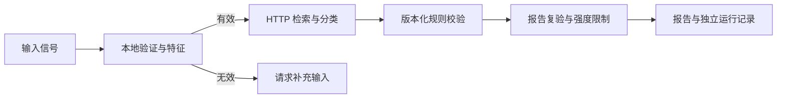

# DiagEvidence 架构与执行语义

`DiagnosisAgent` 是固定工具流程：本地输入/特征检查 → 可选健康探测 → 案例检索 → 分类 → 校验 → 受约束报告。工具异常转成结构化失败，校验明确区分失败与未知。输入质量不满足要求时直接 `ASKING_USER`，不调用任何外部服务。

工具响应统一为 `ok,status,data,warnings,errors,evidence,duration_ms`。`status` 包含 `ok,degraded,unavailable,invalid_input,error`，`ok` 仅在 `status=ok` 时为真。任务终态与工具状态不同：`COMPLETED` 表示规则通过且产物按配置生成；`DEGRADED` 表示可返回受限制结果；`ASKING_USER` 表示本地输入不足；`FAILED` 表示关键报告/校验步骤失败。

规则等级和诊断结果有效性分开，`support_level` 是规则支持等级，兼容字段 `trust_level` 与之同值。`max_allowed_strength` 为政策上限，`effective_strength` 为报告实际采用值。即使上限为strong，当前合法分类适配器通常只请求moderate。不能把上限当作实际强度。

每次调用产生UUID运行编号，报告独占创建；轨迹与审计各有独立文件。返回值为深拷贝，复用实例不会修改旧结果。同一实例并发调用会抛出明确的RuntimeError；并发任务使用不同实例。日志或报告写入失败会显示在响应中，不能返回完整成功状态。

`Settings` 不共享可变实例。输出目录位于调用方可写路径；核心库不会写入安装包。`persist_trace=False` 默认关闭所有落盘，亦可显式用`persist_outputs=False`关闭。日志使用摘要白名单，递归过滤常见凭据字段及禁止载荷；任意未知敏感文本的自动识别没有完备保证。

测试通过可注入transport验证规则，通过真实回环HTTP验证JSON/状态码/重试/超时，并通过安装后的CLI验证分发包。替身代表合成工具响应，不能证明真实检索或分类有效性。
